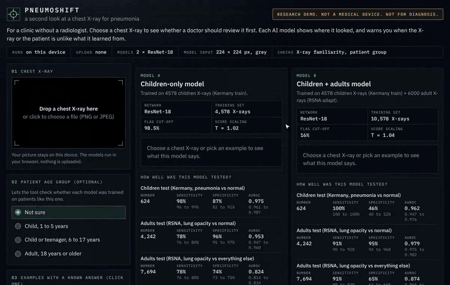
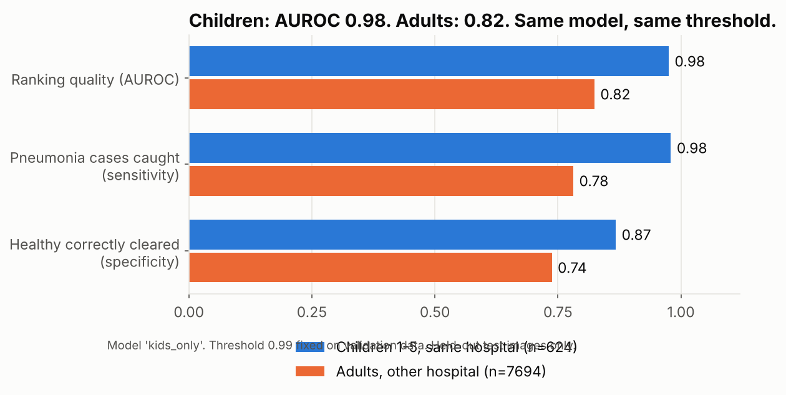
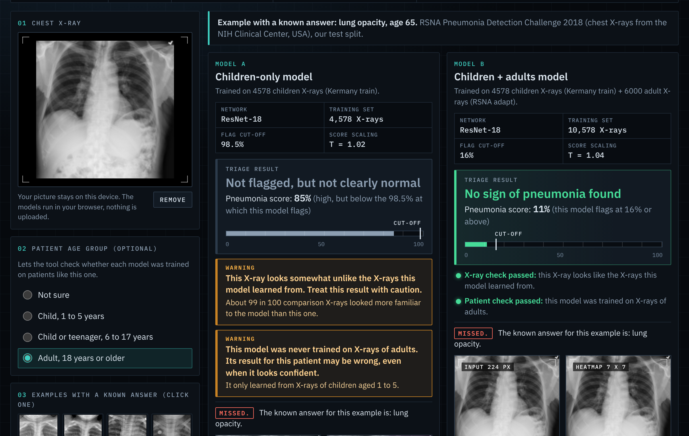
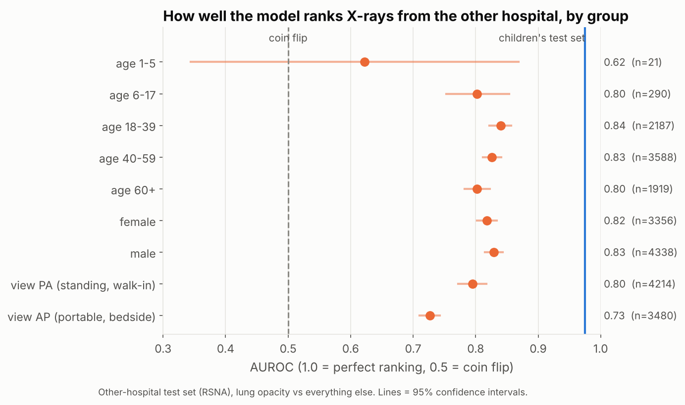
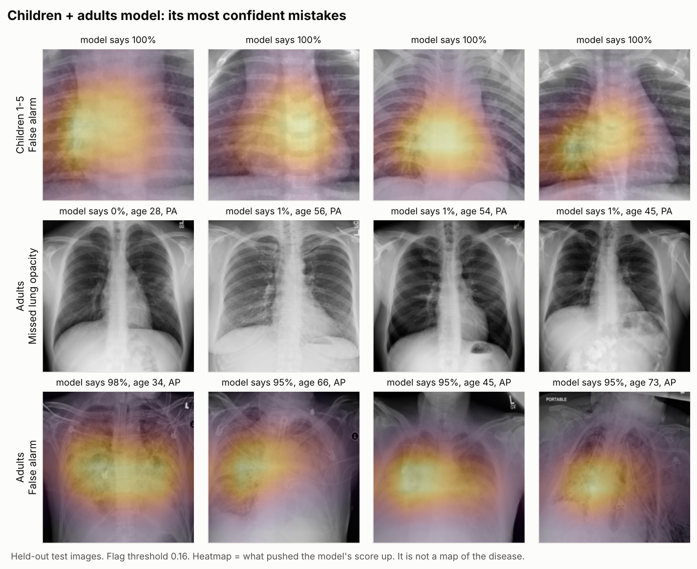
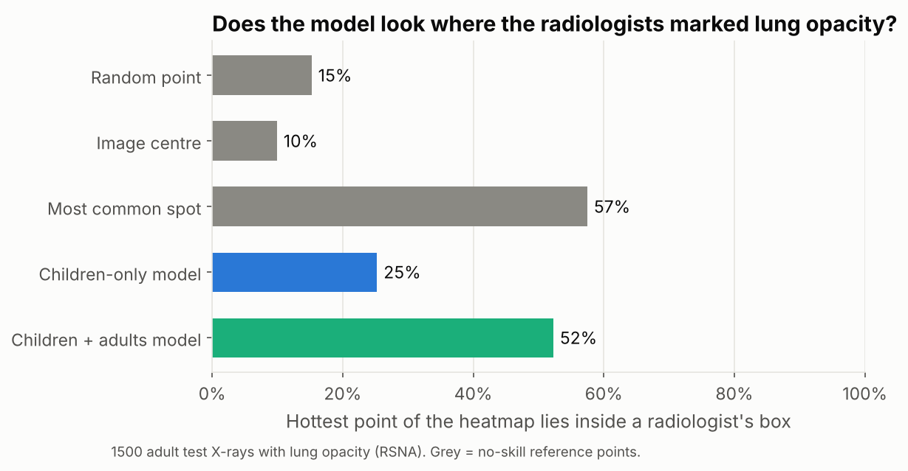

# PneumoShift

**A second look at a chest X-ray for pneumonia, for a clinic without a radiologist, that says when it is out of its depth.**

**Track:** AI + Health  
**Team:** names are in the submission form  
**Try it:** https://huggingface.co/spaces/RL8596/pneumoshift (runs in your browser, nothing is uploaded)  
**Models:** [children-only](https://huggingface.co/RL8596/pneumoshift-kids-only), [children + adults](https://huggingface.co/RL8596/pneumoshift-kids-plus-adults)

<!-- TEAM: when the video is uploaded, add this line under "Try it" and end it with two spaces:
**Video (2 minutes):** the link -->

This project is a prototype and is not medical advice.  
Research demo. Not a medical device. Not for diagnosis.

---

## The problem

A small clinic takes a chest X-ray, but no radiologist is there to read it, so the clinic's own doctor has to.
In Malawi, a survey published in 2022
counted 3 radiologists for 19.7 million people [15]. A tool that sorts X-rays into "look at this one first" could save hours for the patients
who need them most.

One of us lost a grandmother whose pneumonia was misdiagnosed, and has a mother who works in a hospital. That is
why we chose this problem, and why the AI + Health track fit us exactly.

The usual way to build such a tool is a well-known tutorial: train a network on a public dataset of chest X-rays
and report over 90% accuracy. That dataset holds **only children aged 1 to 5 from one hospital in China** [1, 2].
Pneumonia is the largest infectious cause of death in children [13]. But in 2021 more than twice as many people
aged 70 and over died of lung infections as children under 5 [14].

**Our question: what happens when the tutorial model meets adults from another hospital, and can the tool notice it?**
Three papers in 2026 already showed that such a model gets worse on adults [9, 10, 11]. We repeat that result and
do not claim it. What we add, to our knowledge, is the part a clinic needs: *how* it fails, a built-in warning,
and what it takes to repair it.

## What we built



*The demo in 15 seconds. We choose the chest X-ray of a healthy 46-year-old from the adult test X-rays, which
neither model saw in training. The children-only model gives it a score of 90% and warns that the X-ray is unlike
the ones it learned from. The second model says 5%: no sign of pneumonia. The same clip as a sharper video:
[demo.mp4](docs/media/demo.mp4).*

- **What goes in:** a chest X-ray (PNG or JPEG) and, if known, the patient's age group.
- **What comes out:** for two models side by side, a flag ("review this one first" or not), a score, a heatmap of
  where the model looked, and two warnings: the X-ray looks unlike the X-rays the model learned from, or the
  patient's age group was never in its training data.
- **How someone would use it:** open the [demo](https://huggingface.co/spaces/RL8596/pneumoshift) on a computer or
  a phone and choose the X-ray. Both models run inside the browser, so the picture never leaves the device and
  nothing has to be installed. A flagged X-ray goes to the top of the doctor's pile. A warning means: do not rely
  on this result.

## What we added

We started from the suggested project 4.1.1, pneumonia screening from chest X-rays, and added three things of our
own:

- **Our own setting:** a clinic without a radiologist, where the tool sorts which X-ray a doctor sees first.
- **Our own data:** a second public dataset, 26,684 chest X-rays of adults from another hospital [3]. The tutorial
  dataset holds only children.
- **Our own question:** what happens when the tutorial model meets those adults, and can the tool notice it? We
  measured how it fails, built a warning for X-rays unlike the training data, and tested what that warning can and
  cannot do.

## How it works

**Data.** Two public datasets. We split each by patient, so nobody is in both the training and the test data.

| | Children | Adults |
|---|---|---|
| Source | Kermany et al. [1]: one hospital in Guangzhou, China, ages 1 to 5 | RSNA Pneumonia Detection Challenge 2018 [3]: NIH Clinical Center, USA |
| X-rays | 5,856 | 26,684 (of 11,452 patients) |
| Training pool / validation / test | 4,578 / 654 / 624 | 16,010 / 2,667 / 8,007 (7,694 of them adults) |

How we cleaned it: every picture is turned grey, cut to a square and reduced to 256 pixels, and the model sees
the middle 224. We compared all 32,540 pictures with each other: none is shared between training and test data.
The adult dataset's "patientId" turned out to be an exam number, so our first, random split put the same people
in training and test (5,493 of 8,006 test exams, about two thirds). We split by the real patient number instead.

The adult X-rays come in three kinds: normal, lung opacity, and no lung opacity but not normal ("sick with
something else"). Lung opacity is what a radiologist marked on the picture. It is not a confirmed pneumonia [5].

**Model.** ResNet-18 [18], a standard image network, pretrained on everyday photos (ImageNet) and loaded from the
Hugging Face Hub (`timm/resnet18.tv_in1k`). We fine-tuned it to give one score per X-ray. Why this network: it is
what the tutorials use, it trains in minutes, and at 45 MB it is small enough to run in a browser. We trained it
twice: on the children only (the tutorial), and on the children plus 6,000 adult X-rays. Each model flags above
its own cut-off, fixed before testing so that it catches 95% of the cases in its validation data. The warning
measures how far an X-ray lies from the training X-rays in the network's own description of it [16]. The heatmap
is Grad-CAM [17].

## Results

**The main takeaway:** the tutorial model scores 0.975 on its own test children. On adults from another hospital
it is right for 74.7% of X-rays, fewer than the 77.6% of answering "no" every time. Our warning notices the new
hospital. Adult X-rays repair only part of the damage.



*Figure 1. The children-only model on its own test children and on adults from the other hospital (lung opacity
against everyone else), at the same cut-off. For adults, "pneumonia cases" means lung opacity and "healthy"
means everyone without one. The bars do not show the share of right answers named above: that is 93.8% for the
children and 74.7% for the adults.*

All numbers come from test X-rays of patients the models never saw: 624 X-rays of children and 7,694 X-rays of
adults.
AUROC measures how well a model ranks sick above healthy: 0.5 is guessing, 1.0 is perfect.
"Adults" means: lung opacity against everyone else, including adults who are sick with something else.

| | Children, same hospital | Adults, other hospital |
|---|---|---|
| *Baseline:* raw pixels + logistic regression, trained on children | 0.847 | 0.727 |
| *Baseline:* ImageNet network without fine-tuning + logistic regression, trained on children | 0.953 | 0.752 |
| *Baseline:* the same network + logistic regression, trained on adults | | 0.848 |
| **Our children-only model (the tutorial)** | **0.975** | 0.824 |
| **Our children + 6,000 adults model** | 0.962 | **0.874** |

Trained on the same children, our best baseline scored 0.953 on children and 0.752 on adults. Our children-only
model scored 0.975 and 0.824. For our second model the fair baseline is the one trained on adult X-rays: it
scored 0.848 and our model 0.874, which is 0.025 more (95% interval 0.019 to 0.033). All of this is on held-out
test data. Further models and baselines are in the table under "All results" below.

**Where it fails, and why we think so**

- **As a tool, the tutorial model is worse than a constant answer on adults.** With its cut-off it is right for
  74.7% of adults, while "nobody has pneumonia" is right for 77.6% and catches no one. Why: the cut-off was set on
  children and does not carry over. Accuracy is a hard yardstick when 78% of patients are negative, so we also
  report cases caught and non-cases cleared everywhere.
- **It mistakes other illness for pneumonia.** It flags 42% of adults who are sick with something else (the second
  model: 57%), and 94% of its false alarms are such adults. Why, we think: the children's data knows only two kinds
  of picture, healthy and pneumonia, so the model learned "this lung looks abnormal", not "this is pneumonia".
- **One cut-off does not fit both kinds of X-ray.** It catches 93% of cases on bedside X-rays but only 28% on
  standing X-rays, the kind a small clinic takes. Why, we think: bedside X-rays are taken of sicker patients and
  look different, and the model scores them higher. Knowing only "bedside or standing", without looking at the
  picture, already scores 0.706.
- **The warning notices the wrong hospital, not the wrong answer.** It fires for 7% of the children's test X-rays
  and 81% of the adults', but it cannot tell which adult answers are wrong.
- **The heatmaps do not show where the disease is.** Their hottest point lies inside a radiologist's box for 25%
  (children-only) and 52% (children + adults) of X-rays. Always pointing at the most common spot scores 57%.
- **More adult data stopped helping.** All 15,142 adult X-rays instead of 6,000 gave 0.880 against 0.874. By the
  rule we wrote down before training, that is not a shown improvement (section 6).

**One X-ray that both models get wrong**



*The demo example "Adult (65), lung opacity": a standing X-ray on which a radiologist marked a lung opacity.*

Neither model flags it. The scores are 85% and 11%, both below the cut-offs. The children-only model at least
shows its warnings. The second model shows none, because to it this X-ray looks ordinary: the warning notices an
unfamiliar hospital, not a wrong answer. Why it happens, we think: standing X-rays get lower scores than bedside
ones, and one cut-off has to serve both. At their cut-offs both models miss more cases on standing X-rays than on
bedside ones. Figure 3 in section 3 shows more mistakes of each kind.

## What we'd do next

1. **Test on a third hospital with confirmed diagnoses.** We have two hospitals, and our adult labels are
   radiologists' findings on the picture, not confirmed pneumonia [5].
2. **Teach the model a third answer: "abnormal, but not pneumonia".** The adult dataset has that label. It aims at
   the most common failure, the false alarms for other illnesses.
3. **Let a clinic set its own cut-off** from a few hundred of its own X-rays, separately for bedside and standing
   pictures, and measure how many it needs.

## Sources

The full list of sources is in section 12. The main ones:

- **Datasets:** chest X-rays of children, Kermany et al. 2018 [1], licence CC BY 4.0,
  https://data.mendeley.com/datasets/rscbjbr9sj/2 (copy we used: https://huggingface.co/datasets/hf-vision/chest-xray-pneumonia).
  Chest X-rays of adults, RSNA Pneumonia Detection Challenge 2018 [3],
  https://www.rsna.org/rsnai/ai-image-challenge/rsna-pneumonia-detection-challenge-2018
  (copy we used: https://huggingface.co/datasets/kellly/RSNA-Pneumonia-Detection).
- **Pretrained model:** ResNet-18 with ImageNet weights [18], https://huggingface.co/timm/resnet18.tv_in1k
- **Software:** PyTorch, timm, scikit-learn, ONNX Runtime Web, Hugging Face Hub [20].
- **Tutorials:** our question starts from the common pneumonia tutorials built on [1], for example the Keras
  example https://keras.io/examples/vision/xray_classification_with_tpus/. We did not copy code from a tutorial.
- **AI tools:** Claude Code, an AI coding assistant by Anthropic [26], https://claude.com/claude-code.
  How we used it is in section 11. The demo video was edited by Claude.

---

## More results

The write-up ends above. From here on comes the detail behind it, for readers who want to check us.

### All results

AUROC measures how well a model ranks sick above healthy: 0.5 is guessing, 1.0 is perfect.
"Adults" means: lung opacity against everyone else, including adults who are sick with something else.

| | Children, same hospital | Adults, other hospital |
|---|---|---|
| Children-only model (the tutorial) | **0.975** | 0.824 |
| Children + 6,000 adults | 0.962 | **0.874** |
| Children + all 15,142 adults (second generation, section 6) | 0.973 | 0.880 (not a shown improvement, see below) |
| *Baseline:* raw pixels + logistic regression, trained on children | 0.847 | 0.727 |
| *Baseline:* ImageNet network, not fine-tuned, + logistic regression, trained on children | 0.953 | 0.752 |
| *Baseline:* the same ImageNet network + logistic regression, trained on adults | | 0.848 |
| *Baseline:* looks at no picture, only at "bedside or standing X-ray" | | 0.706 |
| *Extra check, exploratory, not in the demo:* three networks of the 15,142 recipe answer together (section 6) | 0.976 | 0.886 (does not change the verdict, see below) |

The demo runs the first two rows. All other rows are tests only.

### More adult data: what it did and what it did not

6,000 adult X-rays lift the adult score from 0.824 to 0.874. We then trained 22 more models under a plan written
down in advance (section 6). With all 15,142 adult X-rays the score is 0.880: a difference of +0.006 (95% interval
-0.000 to +0.011), which by our own rule is not a shown improvement. A simple baseline gets most of the way: a
network that was never fine-tuned, plus a simple classifier trained on the adult X-rays, reaches 0.848. The
fine-tuning of our second model adds 0.025 to that (95% interval 0.019 to 0.033).

**Extra check, not part of the plan.** On the last day we let three networks of that recipe answer together: for
each X-ray we took the mean of their three scores. Together they score 0.886. That is +0.012 over the 6,000-adult
model (interval +0.007 to +0.017). Half of it is the averaging itself. The other half is the +0.006 from above,
which is not a shown improvement. This check is exploratory: we had already seen the test results when we ran
it, and it sets three networks against one. It cannot count as proof, and the verdict above stays.

### What did not work

- Retraining only the last layer with adult X-rays barely helps (0.821 to 0.839 with all 15,142).
- The repaired model pays for adults with children: at its threshold it clears only 46% of healthy children
  (the children-only model: 87%).
- No model, old or new, beats "always no" in accuracy at the 95%-sensitivity screening threshold.
- Two and a half times more adult X-rays (15,142 instead of 6,000) did not give a clearly better model (section 6).
  The extra check with three networks answering together (exploratory, section 6) does not change this: it sets
  three networks against one.
- A network pretrained on another hospital's chest X-rays, used without fine-tuning, was no better than the
  ImageNet one (an extra check, section 6).
- A Gradio demo on Hugging Face was refused, so we rebuilt the demo to run in the browser.

### Limits

Two hospitals, public data, one training run per published model. "Lung opacity" on the adult X-rays is a
radiologist's finding on the picture, not a confirmed pneumonia [5]. No authority has checked this tool.
The models see pictures of 224 by 224 pixels. Studies disagree on how much sharper pictures help [24, 25], and we
did not test it.
The second generation of models (section 6) adds more adult data, three random seeds and a comparison plan fixed
in advance ([docs/V2_PROTOCOL.md](docs/V2_PROTOCOL.md)). The demo runs the two published models, not the
second generation.

---

## Details

### 1. Data

| | Children | Adults |
|---|---|---|
| Source | Kermany et al. 2018, Guangzhou Women and Children's Medical Center [1, 4]. Licence CC BY 4.0. Hub: `hf-vision/chest-xray-pneumonia` | RSNA Pneumonia Detection Challenge 2018, X-rays of the NIH Clinical Center, USA [3, 5, 6]. Hub: `kellly/RSNA-Pneumonia-Detection` |
| Size | 5,856 X-rays, ages 1 to 5 | 26,684 exams of 11,452 patients, with age, sex, view and radiologists' boxes |
| Labels | normal, pneumonia | normal; no lung opacity but not normal ("sick with something else"); lung opacity |
| Our split, by patient | train 4,578 / validation 654 / official test 624 | training pool 16,010 / validation 2,667 / test 8,007 (7,694 adults) |

- **Validation data** is used for every choice (which training round to keep, the threshold). **Test data** is
  only scored. Nothing was tuned on test data.
- The adult dataset also holds 1,276 X-rays of minors and 5 with an impossible age in the file header. These
  1,281 are left out of all adult results. The minors are used for one check only (section 4).
- We examined a third dataset ("Epic Chittagong" on the Hub) as independent test data and rejected it: it contains
  copies of the children's images.

### 2. Models and the threshold rule

- ResNet-18 pretrained on ImageNet (`timm/resnet18.tv_in1k` from the Hugging Face Hub), fine-tuned whole, one output.
  Pictures are made grey, cut to a square and reduced to 256 pixels, and the model sees the middle 224. Light
  augmentation, no left-right flips (the heart is on one side).
- **Threshold rule, fixed before testing:** the highest threshold that still catches 95% of the pneumonia cases
  in the validation X-rays. A screening tool should miss few cases, and pays for that with false alarms.
- Each model's scores are rescaled with one number chosen on validation data (temperature scaling [19]). Even so,
  the score is not the chance that the patient has pneumonia. On adults the children-only model's scores are far
  off (calibration error 0.40; 0 would be perfect), the second model's are close (0.03).

### 3. How the children-only model fails on adults

Test patients only. Threshold 0.985, chosen on children's validation X-rays.

| Test group | X-rays | AUROC | Cases caught | Non-cases cleared | Right answers | "Always the same answer" |
|---|---|---|---|---|---|---|
| Children 1 to 5, same hospital | 624 | 0.975 | 97.9% | 86.8% | 93.8% | 62.5% |
| Adults, lung opacity vs normal | 4,242 | 0.953 | 78.1% | 96.0% | 88.8% | 59.4% |
| Adults, lung opacity vs everyone else | 7,694 | 0.824 | 78.1% | 73.8% | 74.7% | 77.6% |

Figure 1, under "Results" above, shows the first and the third row as bars.

- **By diagnosis:** it flags 4% of normal adults, 42% of adults who are sick with something else, 78% of adults
  with lung opacity.
- **By X-ray view:** standing (PA): 28% of cases caught, 95% of non-cases cleared. Bedside (AP): 93% caught, 36%
  cleared. Sicker patients are X-rayed in bed, so the view alone predicts the label (0.706).
- **By age and sex:** small differences (AUROC 0.841 at 18 to 39, 0.802 at 60 and over; women 0.818, men 0.829).



*Figure 2. Ranking score (AUROC) of the children-only model inside each group of the other hospital's test
X-rays. The lines are 95% intervals. The group aged 1 to 5 holds only 21 X-rays.*

The second model (children + 6,000 adults, threshold 0.157 chosen on children's and adult validation X-rays together):

| Test group | AUROC | Cases caught | Non-cases cleared | Right answers |
|---|---|---|---|---|
| Children 1 to 5 | 0.962 | 100% | 45.7% | 79.6% |
| Adults, lung opacity vs normal | 0.979 | 91.1% | 94.8% | 93.3% |
| Adults, lung opacity vs everyone else | 0.874 | 91.1% | 65.0% | 70.8% |

It still flags 57% of adults who are sick with something else. Telling lung opacity from other lung disease is the
hard part, and more adult data did not solve it.

**Examples the model gets wrong.**



*Figure 3. The most confident mistakes of the children + adults model on test X-rays. Top: healthy children it
flags. Middle: adults with a lung opacity it misses; all four are standing X-rays (PA). Bottom: adults without a
lung opacity it flags; all four are bedside X-rays (AP). It misses no child with pneumonia in the test set, so
there is no such row. The same picture for the children-only model:
[heatmap_failures_kids_only.png](results/figures/heatmap_failures_kids_only.png).*

**A fairer comparison of the two models.** Each model above sits at a different point: the first catches 78% of
adult cases, the second 91%. With the threshold chosen on adult validation X-rays, so that both catch about 95%:

| Model | Adults: cases caught | Non-cases cleared |
|---|---|---|
| Children-only | 95% | 44% |
| Children + 6,000 adults | 96% | 50% |
| Frozen ImageNet network + logistic regression, trained on adults | 97% | 41% |

### 4. The "unlike my training data" warning

For every X-ray the model produces 512 internal numbers. We measure how far they lie from those of the training
X-rays (Mahalanobis distance [16]) and warn above the level that 95% of the validation X-rays stay below.

- Children-only model: fires for 7.2% of children's test X-rays and 80.6% of adults'.
- **It detects the hospital, not the age.** It also fires for 97% of the other hospital's patients under 18.
- **It is not an error detector.** Among adults it does not single out the wrong answers.
- For the second model the picture turns around: the warning fires for 24% of children and 1% of adults. It always
  means "unlike this model's own training mix".

### 5. Heatmaps against radiologists' boxes

On 1,500 adult test X-rays with boxes drawn by radiologists, we asked: does the hottest point of the heatmap
(Grad-CAM [17]) lie inside a box?

| Random point | Image centre | Always the most common spot | Children-only model | Children + adults model |
|---|---|---|---|---|
| 15% | 10% | 57% | 25% | 52% |



*Figure 4. The heatmap test. Grey bars are reference points that need no model.*

The heatmap has a 7 by 7 grid, so it is coarse. The demo says that it shows what influenced the model and is not a
map of the disease.

### 6. Second generation of models: does more adult data help?

We wanted a stronger repaired model. Before training anything we wrote down what would be trained, which
model would be the headline, how it would be compared, and what "good" means:
[docs/V2_PROTOCOL.md](docs/V2_PROTOCOL.md). In short:

- One recipe, 22 runs on a GPU: children + 0 / 300 / 1,000 / 3,000 / 6,000 / all 15,142 adult X-rays, three
  random seeds for the main points, and an adults-only model.
- The headline model is fixed by name. No model is picked because of its test result.
- Test results are computed once, by `scripts/10_v2_report.py`, with intervals that resample patients.
- We wrote in advance that we do not expect it to beat "always no" at the screening threshold.

All 22 runs finished on 14 Nov. The test results were computed once. Full tables:
[results/v2_report.md](results/v2_report.md).

**The one comparison we committed to in advance.** Adult test X-rays, lung opacity against everyone else: the
headline model (children + all 15,142 adult X-rays) scores 0.880, the published model (children + 6,000) scores
0.874. The difference is +0.006 (95% interval -0.000 to +0.011). The interval touches zero, so by our own rule
**no improvement is shown**. Two and a half times more adult X-rays did not give a clearly better model.

Adults, test X-rays (n = 7,694). In this table both thresholds are chosen on adult validation X-rays for every
row, also for the published models, so the rows can be compared. (Section 3 shows the published models at the
thresholds they were built with.) "Screening" aims at catching 95% of the cases. "Strict" aims at clearing 95% of
the non-cases; we added it on 14 Nov, after the test results of the first two models were known.

| Model | AUROC (95% interval) | Standing X-rays | Bedside X-rays | Screening: caught / cleared | Strict: caught / cleared |
|---|---|---|---|---|---|
| *Baseline:* ImageNet network, not fine-tuned, + logistic regression on the adult X-rays | 0.848 (0.834 to 0.863) | 0.819 | 0.776 | 97% / 41% | 39% / 94% |
| Children only (published) | 0.824 (0.809 to 0.839) | 0.795 | 0.727 | 95% / 44% | 29% / 94% |
| Children + 6,000 adults (published) | 0.874 (0.861 to 0.886) | 0.865 | 0.811 | 96% / 50% | 46% / 94% |
| New recipe, children + 6,000 adults | 0.872 (0.859 to 0.885) | 0.874 | 0.805 | 96% / 52% | 48% / 94% |
| **New recipe, children + all 15,142 adults (headline)** | 0.880 (0.867 to 0.892) | 0.876 | 0.823 | 96% / 51% | 49% / 95% |
| New recipe, adults only (15,142) | 0.878 (0.865 to 0.890) | 0.876 | 0.818 | 95% / 56% | 49% / 94% |

What else the runs show. These points describe the results; only the comparison above was a test fixed in advance.

- **The repair curve flattens.** Adult score by number of adult X-rays added, mean of three random seeds (lowest
  to highest run): 0 → 0.831 (0.820 to 0.841), 300 → 0.834 (0.829 to 0.837), 1,000 → 0.853 (0.850 to 0.856),
  3,000 → 0.857 (0.846 to 0.863), 6,000 → 0.871 (0.870 to 0.872), 15,142 → 0.881 (0.880 to 0.882). Inside the new
  recipe the last step is worth +0.008 (95% interval +0.002 to +0.013). It comes from bedside X-rays (+0.017), not
  from standing ones (+0.002, interval -0.008 to +0.013). On the validation X-rays the two had looked almost the
  same (0.870 and 0.875).
- **Still below "always no" in accuracy at the screening threshold, as we wrote in advance.** The headline model
  catches 96% of the cases (interval 93% to 98%) and clears 51% of the others (41% to 60%). That makes it right
  for 60.9% of adults; "always no" is right for 77.6% and catches no one.
- **Standing X-rays, the small clinic's case** (4,214 X-rays, 9.3% with lung opacity). At the screening threshold
  the headline model catches 90% (84% to 96%) and clears 65% (54% to 74%). The published model: 85% (76% to 91%)
  and 70% (62% to 80%). The intervals overlap, so this is not a shown difference either.
- **Children's X-rays neither help nor hurt on adults.** With them 0.880, without them 0.878 (difference +0.002,
  interval -0.002 to +0.006). On children the adults-only model is clearly worse: 0.905 (three runs: 0.879 to
  0.930) against 0.973.
- **The children still pay.** With its threshold chosen on adults, the headline model catches every child with
  pneumonia in the test set but clears only 32% of the healthy children.
- **The scores became more honest, and the view shortcut weaker.** Calibration error on adults: 0.398 for the
  children-only model, 0.029 for the published repaired model, 0.018 for the headline model. We also measured how
  well a model's score tells a bedside X-ray from a standing one among *normal* adults (0.5 means the score ignores
  the view): children-only 0.92, published children + adults 0.87, new recipe with the same 6,000 X-rays 0.69,
  headline 0.64. We did not predict this, and single runs cannot tell us which change in the recipe caused it.
- **A bigger network did not change the picture.** One ResNet-50 run on the same data: 0.884.
- **An extra check that was not part of the plan: a network pretrained on chest X-rays.** After the first
  validation result we tried the other obvious lever, a better starting point: a public DenseNet-121 trained on
  chest X-rays from Stanford Hospital [21, 22], used without fine-tuning. Networks trained on the NIH collection
  were excluded because they have already seen our test X-rays. As published it scores 0.801. With logistic
  regression on its features, trained on our adult X-rays, it scores 0.848: the same as the ImageNet baseline
  (difference -0.001, interval -0.008 to +0.006). We did not fine-tune it, so this says nothing about fine-tuning
  such a network.
- **A second extra check, on the last day (exploratory): three networks answer together.** **Read this with
  care.** We ran this check after we had seen the test results of all single models. It is a second look at the
  test X-rays, not a proof, and it does not change the verdict above. The demo does not use the averaged model.
  - *What we did.* The plan had trained the headline recipe three times with different random seeds. For each
    X-ray we took the mean of the three networks' scores (an "ensemble", a common step in chest X-ray work
    [22, 23]). This needs no new training. We committed the rules before we computed any number of the averaged
    model ([docs/V2_ADDENDUM_ENSEMBLE.md](docs/V2_ADDENDUM_ENSEMBLE.md)): the three members by name, a plain
    mean, the same comparison rule as before.
  - *Result.* 0.886 (0.874 to 0.898). This is not the mean of the three runs' own results, which is 0.881 (repair
    curve above). It is +0.012 over the published model (+0.007 to +0.017) and positive inside both views
    (standing +0.023, bedside +0.017).
  - *Why this is not a confirmation.* In the planned comparison such a result would have counted as better. Here
    it does not, for three reasons. We already knew that each of the three runs alone scored above the published
    model (0.880 to 0.882 against 0.874). Averaging networks usually raises the score a little. And it sets three
    networks against one. Half of the gain is the averaging itself: +0.006 over the headline run (+0.004 to
    +0.008), which was the lowest of the three runs. The other half is the +0.006 of the planned comparison,
    which is not a shown improvement. We did not average three runs with 6,000 adult X-rays, so this check does
    not show that more adult X-rays help.
  - *At the thresholds.* At the screening threshold it catches 97% of the cases and clears 54% of the others
    (published model: 96% and 50%). That is about 32 fewer false alarms per 1,000 adults, but the intervals of
    the two models overlap (44% to 65% against 43% to 59%). It is right for 63.8% of adults, still below "always
    no". At the strict threshold it is about the same as one run, and its calibration error is a little higher
    than the headline run's. Averaging all seven networks that were trained with all adult X-rays gives 0.889.
  - *The price.* Three networks instead of one, so three times the download and the computing time.
    Full table: [results/exploratory/ensemble.md](results/exploratory/ensemble.md).

**What this means for the clinic.** About 6,000 labelled local X-rays bring nearly all of the gain. Beyond that,
more X-rays of the same kind add about 0.01. The gap that remains is not closed by more data of the same kind.
An extra check (exploratory, see the last point above) suggests that three networks answering together add about
0.006 more. That costs three times the computing time. Our demo does not do this.

### 7. Checks on the data

- No image is shared between training and test, or between the two datasets. 32 exact duplicates sit inside
  single splits of the children's data.
- **Shortcuts in the children's data:** the image size alone predicts the label (AUROC 0.879), the brightness
  alone 0.871. A model can look good there for the wrong reasons [12].
- A simple classifier tells the two hospitals apart with AUROC 0.998, and still 0.951 for children of the same age.
- On the children's data, validation looks better than test (even raw pixels reach 0.99 on validation and 0.847
  on test), so the official test set differs from the training pool.
- **A leak in our own first split of the adult data.** The dataset's "patientId" is an exam number. A random
  split put the same people in training and test (5,493 of 8,006 test exams in that first split, about two
  thirds). We split by the real patient number instead.

### 8. The demo

`web/` is a static page. Both models run on the visitor's device with ONNX Runtime Web, so the picture never
leaves it. The page repeats the Python preprocessing step for step. `tests/web/parity.mjs` opens the page in a
headless browser and compares it with the Python code on 15 pictures: the model input is identical byte for byte,
and every decision and warning matches. `app/` holds the same demo as a Gradio app.

### 9. How to run

```bash
pip install -r requirements.txt
python scripts/01_prepare_data.py     # downloads about 5 GB from the Hugging Face Hub
python scripts/hub_models.py pull     # the published models and their per-image scores
```

| Step | Command |
|---|---|
| Train | `python scripts/02_train.py --name my_model` (add `--rsna-n 6000` for adult X-rays) |
| Data checks, baselines | `python scripts/03_audit.py`, `python scripts/04_baselines.py` |
| Children vs adults | `python scripts/05_shift_analysis.py --model <name>` |
| Heatmap test | `python scripts/06_heatmap_check.py --models kids_only kids_plus_adults` |
| Final comparison | `python scripts/10_v2_report.py test --v1-only` |
| Demo | open `web/index.html` through a local web server, or `python app/app.py` |
| Demo clip in this README | `node tests/web/record_demo.mjs docs/media` |
| Notebook | `notebooks/pneumoshift_colab.ipynb` holds the same steps for Colab. We did not get to test it there. |

Training one model takes about an hour on a CPU and a few minutes on a GPU.

### 10. What is ours and what is not

- **Not ours:** the two datasets, the pretrained network, the finding that a children-trained model is worse on
  adults [9, 10, 11], and the general lesson that medical models can fail in a new hospital [7, 8].
- **Ours, to our knowledge:** the breakdown of the failure by X-ray view and by diagnosis; the comparison against
  baselines that never look at the picture; the warning tested for what it can and cannot do; the heatmap test
  against radiologists' boxes with no-skill reference points; the patient-level split of the adult data; and a
  demo that runs both models in the browser.

### 11. Use of AI assistance

We used an AI coding assistant (Claude, by Anthropic) throughout: to write and review most of the code, to run
the experiments, and to draft this text. Our mission was not only to build something, but to learn a lot along
the way. So both of us made sure that we understand every part of the project: what each step does, why it is
there, and what the numbers mean. We chose the question, the user and the direction, checked the results, and
are responsible for every statement here.

### 12. Sources

Datasets
1. Kermany D, Zhang K, Goldbaum M. Labeled Optical Coherence Tomography (OCT) and Chest X-Ray Images for Classification. Mendeley Data, V2, 2018. doi:10.17632/rscbjbr9sj.2. Licence CC BY 4.0.
2. Mooney P. Chest X-Ray Images (Pneumonia). Kaggle, 2018 (copy of [1]).
3. Radiological Society of North America. RSNA Pneumonia Detection Challenge (2018). Images and annotations.

Papers on the datasets
4. Kermany DS, Goldbaum M, Cai W, et al. Identifying Medical Diagnoses and Treatable Diseases by Image-Based Deep Learning. Cell. 2018;172(5):1122-1131.e9. doi:10.1016/j.cell.2018.02.010
5. Shih G, Wu CC, Halabi SS, et al. Augmenting the National Institutes of Health Chest Radiograph Dataset with Expert Annotations of Possible Pneumonia. Radiology: Artificial Intelligence. 2019;1(1):e180041. doi:10.1148/ryai.2019180041
6. Wang X, Peng Y, Lu L, Lu Z, Bagheri M, Summers RM. ChestX-ray8: Hospital-scale Chest X-ray Database and Benchmarks on Weakly-Supervised Classification and Localization of Common Thorax Diseases. IEEE CVPR. 2017:3462-3471. doi:10.1109/CVPR.2017.369

Generalisation and shortcuts
7. Zech JR, Badgeley MA, Liu M, et al. Variable generalization performance of a deep learning model to detect pneumonia in chest radiographs: A cross-sectional study. PLOS Medicine. 2018;15(11):e1002683. doi:10.1371/journal.pmed.1002683
8. Roberts M, Driggs D, Thorpe M, et al. Common pitfalls and recommendations for using machine learning to detect and prognosticate for COVID-19 using chest radiographs and CT scans. Nature Machine Intelligence. 2021;3(3):199-217. doi:10.1038/s42256-021-00307-0
9. Javier-Tarapaqui J, Vega-Huerta H, Guerra-Grados L, et al. Deep Learning Architecture Comparison for Pneumonia Detection in Pediatric Chest X-Rays: Ensemble Learning and Cross-Population External Evaluation. Applied Sciences. 2026;16(21):11063. doi:10.3390/app162111063
10. Gómez-Vela F, López-Fernandez A, Divina F, García-Torres M. Performance-interpretability trade-offs and generalization in deep learning for pneumonia detection: A benchmarking study. Applied Intelligence. 2026;56(14):414. doi:10.1007/s10489-026-07398-5
11. Neo RYS. Benchmarking knowledge distillation for lightweight pneumonia detection: a multi-seed calibration study on PneumoniaMNIST. BMC Research Notes. 2026;19(1):270. doi:10.1186/s13104-026-07793-8
12. Geirhos R, Jacobsen J-H, Michaelis C, et al. Shortcut learning in deep neural networks. Nature Machine Intelligence. 2020;2(11):665-673. doi:10.1038/s42256-020-00257-z

Impact
13. World Health Organization. Pneumonia in children (fact sheet). 11 November 2022. https://www.who.int/news-room/fact-sheets/detail/pneumonia
14. GBD 2021 Lower Respiratory Infections and Antimicrobial Resistance Collaborators. Global, regional, and national incidence and mortality burden of non-COVID-19 lower respiratory infections and aetiologies, 1990-2021: a systematic analysis from the Global Burden of Disease Study 2021. Lancet Infectious Diseases. 2024;24(9):974-1002. doi:10.1016/S1473-3099(24)00176-2
15. Kawooya MG, Kisembo HN, Remedios D, et al. An Africa point of view on quality and safety in imaging. Insights into Imaging. 2022;13:58. doi:10.1186/s13244-022-01203-w

Methods and software
16. Lee K, Lee K, Lee H, Shin J. A Simple Unified Framework for Detecting Out-of-Distribution Samples and Adversarial Attacks. NeurIPS 2018.
17. Selvaraju RR, Cogswell M, Das A, et al. Grad-CAM: Visual Explanations from Deep Networks via Gradient-based Localization. IEEE ICCV. 2017.
18. He K, Zhang X, Ren S, Sun J. Deep Residual Learning for Image Recognition. IEEE CVPR. 2016. Weights: `timm/resnet18.tv_in1k` (Wightman R. PyTorch Image Models).
19. Guo C, Pleiss G, Sun Y, Weinberger KQ. On Calibration of Modern Neural Networks. ICML 2017.
20. ONNX Runtime Web (Microsoft, MIT licence); PyTorch; scikit-learn; Hugging Face Hub.
21. Cohen JP, Viviano JD, Bertin P, et al. TorchXRayVision: A library of chest X-ray datasets and models. MIDL 2022. Weights used: `densenet121-res224-chex`.
22. Irvin J, Rajpurkar P, Ko M, et al. CheXpert: A Large Chest Radiograph Dataset with Uncertainty Labels and Expert Comparison. AAAI 2019.
23. Ashraf SMN, Mamun MA, Abdullah HM, Alam MGR. SynthEnsemble: A Fusion of CNN, Vision Transformer, and Hybrid Models for Multi-Label Chest X-Ray Classification. International Conference on Computer and Information Technology (ICCIT). 2023. doi:10.1109/ICCIT60459.2023.10441433 (arXiv:2311.07750)
24. Wollek A, Hyska S, Sabel B, Ingrisch M, Lasser T. Higher Chest X-ray Resolution Improves Classification Performance. arXiv:2306.06051, 2023.
25. Sabottke CF, Spieler BM. The Effect of Image Resolution on Deep Learning in Radiography. Radiology: Artificial Intelligence. 2020;2(1):e190015. doi:10.1148/ryai.2019190015
26. Claude Code (Anthropic), an AI coding assistant. https://claude.com/claude-code. How we used it: section 11.
